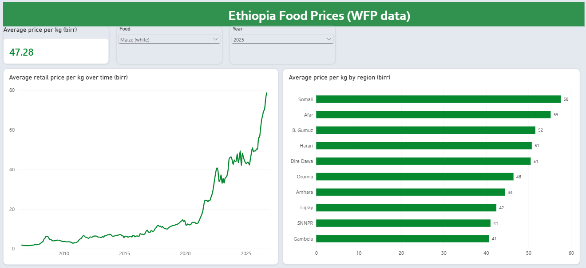

# Ethiopia Food Prices Analysis

I used SQL and Power BI to explore food prices across Ethiopia using data from the World Food Programme (WFP).

### Power BI Dashboard

[**View / Download Power BI Dashboard (.pbix)**](https://github.com/YohanaHiruy/ethiopia-food-prices/blob/main/Ethiopia%20Food%20Prices.pbix)

### What I explored
- Food price changes over time
- Differences in prices across regions
- Comparison of food commodities
- Retail vs. wholesale prices

### Tools
- MySQL – data analysis
- Power BI – dashboard and visualization
- Power Query – data preparation

### Files
- [Power BI Dashboard](Ethiopia%20Food%20Prices.pbix)
- [SQL Queries](food_price_analysis.sql)
- [Original Dataset](wfp_food_prices_eth.csv)
- [Dashboard Screenshot](dashboard.png)

**Author:** Yohana Hiruy

[GitHub Profile](https://github.com/YohanaHiruy)
